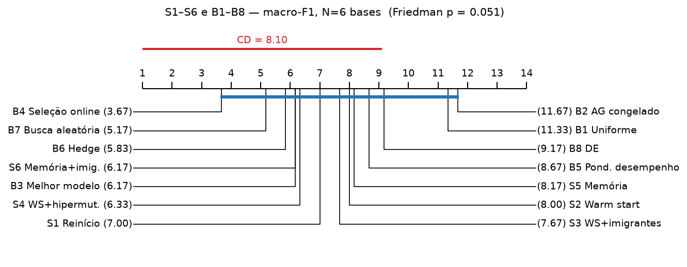
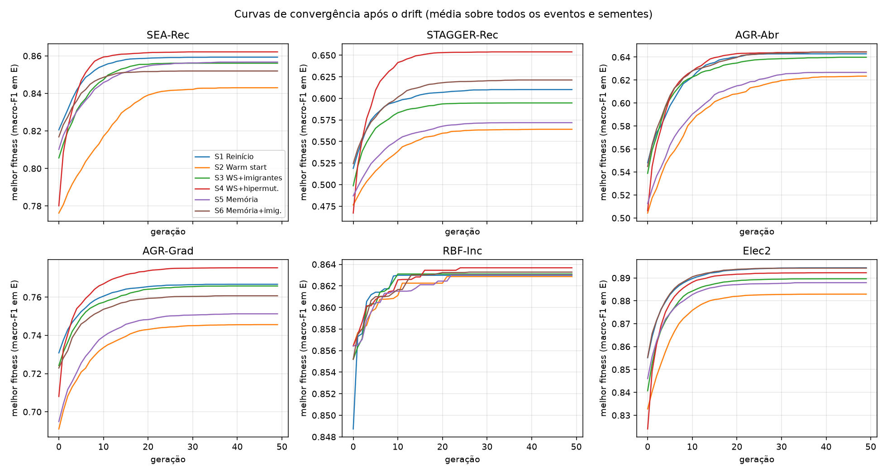
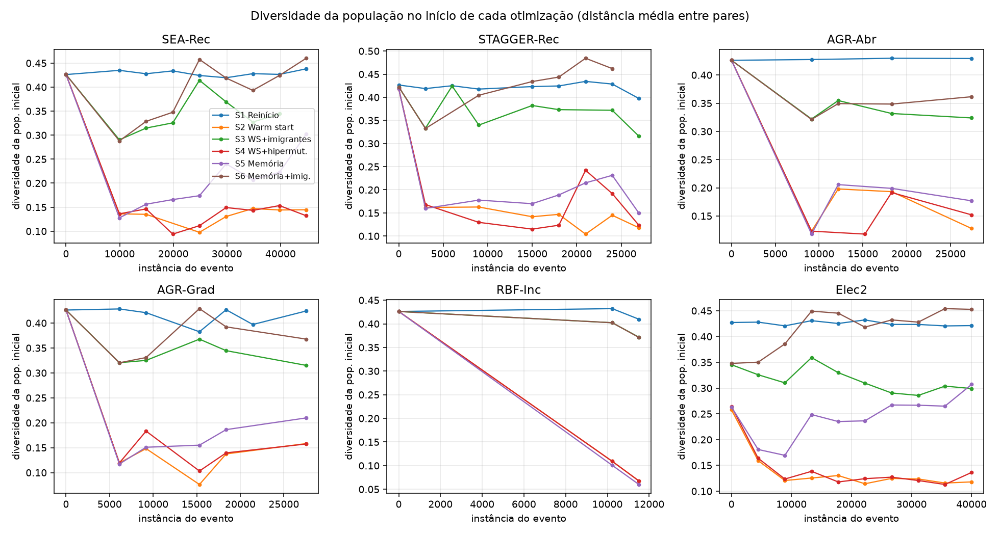
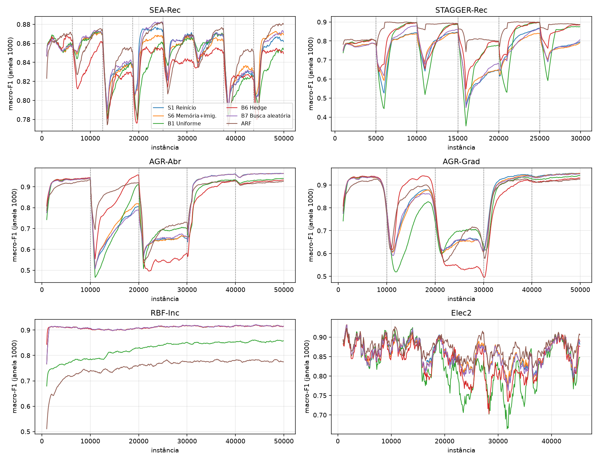
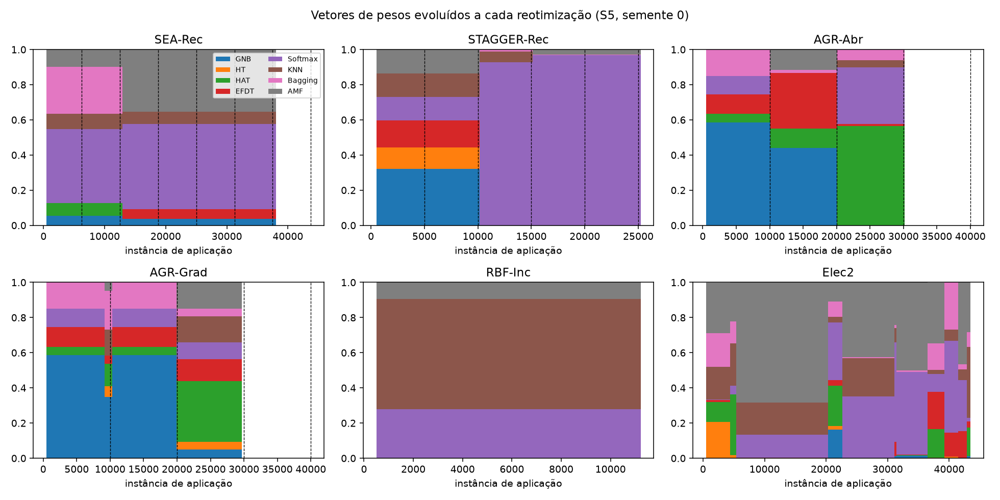
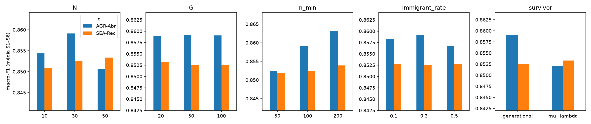

# Algoritmos Evolucionários Dinâmicos para Ponderação de Ensembles Online sob Concept Drift

**Relatório final do projeto — Computação Evolucionária (Mestrado em Ciência da Computação, CIn-UFPE)**
Equipe: [nomes dos integrantes] · Novembro de 2026

---

## Resumo

Modelamos a ponderação de um ensemble online de 8 classificadores incrementais como um problema de otimização
dinâmica no simplex Δ^8. Um AG de codificação real, com fitness igual ao macro-F1 sobre o buffer do warning, é
reacionado a cada drift detectado, e comparamos seis formas de montar a população após a mudança (S1–S6).
Rodamos 9.360 execuções prequenciais (6 bases × 30 sementes × 52 configurações) por replay sobre matrizes de
probabilidade em cache. **Principais achados:** (i) os pesos evoluídos superam a média uniforme em 5 das 6 bases e
o Hedge em 2, mas **não superam a seleção online do melhor modelo recente (B4)**, que fica com o melhor rank médio
entre os métodos de combinação; (ii) **o AG não é melhor que a busca aleatória com o mesmo gatilho e o mesmo
conjunto de avaliação** (0 vitórias, 6 empates, 0 derrotas): no simplex de dimensão 8, com |E| ≈ 100–400, a
paisagem é fácil e 1.500 amostras Dirichlet bastam; (iii) **as seis estratégias pós-drift são estatisticamente
equivalentes** (Friedman p = 0,72), e o warm start não converge mais rápido que o reinício. A única exceção é o
Elec2, onde warm start (S2) e memória (S5) ganham de S1 com significância e efeito grande; (iv) o desempenho
depende mais do **detector e do tamanho de E** do que da estratégia. O oráculo, mesmo sem atraso, perde para o
ADWIN em STAGGER e AGR, porque fixa os pesos por conceito enquanto os modelos ainda estão se readaptando. Por
isso o gargalo do método está no *quando* e no *com que dados* reotimizar, e não em *como* reaproveitar a
população.

## 1. Introdução

Em data streams com *concept drift*, o vetor de pesos que melhor combina os modelos de um ensemble muda ao
longo do tempo. Este trabalho trata a ponderação de um ensemble online como um **problema de otimização
dinâmica (DOP)**: o espaço de busca é o simplex Δ^M dos vetores de pesos, a paisagem de fitness é o macro-F1
do ensemble no conceito atual, e a mudança de ambiente é o drift sinalizado por um detector. Um único
Algoritmo Genético (AG) de codificação real é reacionado a cada drift confirmado, avaliado sobre as
instâncias acumuladas desde o *warning* do detector. A variável experimental central é **como a população é
reaproveitada após a mudança**: comparamos seis mecanismos clássicos de EAs dinâmicos (Nguyen, Yang & Branke,
2012) — reinício, warm start, imigrantes aleatórios (Grefenstette, 1992), hipermutação disparada
(Cobb, 1990), memória (Branke, 1999) e um híbrido — contra baselines não evolucionários, busca aleatória com o
mesmo orçamento, Evolução Diferencial e três ensembles de referência da literatura de streams.

Perguntas de pesquisa (da proposta):

| # | Pergunta | Hipótese |
|---|---|---|
| QP1 | Pesos evoluídos superam esquemas não evolucionários? | H1: AG > uniforme, ponderação por desempenho e Hedge |
| QP2 | O operador evolucionário importa? | H2: AG > busca aleatória com o mesmo orçamento |
| QP3 | Reaproveitar a população ajuda? | H3: warm start converge em menos gerações e recupera mais rápido que o reinício |
| QP4 | Qual mecanismo para cada tipo de drift? | H4a: memória vence em drift recorrente; H4b: imigrantes/hipermutação vencem em drift novo |
| QP5 | Quanto o detector limita o método? | H5: a diferença detector real × oráculo é dominada pelo atraso de detecção |

## 2. Método

### 2.1 Arquitetura

```
stream (x_t, y_t) → pool de M=8 modelos online → P_t (M × C) → ŷ_t = argmax_c Σ_m w_m P_t[m,c]
                                                         ↓ erro 0/1
                                     detector de drift (warning → buffer; drift → AG)
                                                         ↓
                    estratégia pós-drift (S1..S6) monta pop₀ → AG (fitness = macro-F1 em E) → novo w
```

Os modelos base nunca dependem dos pesos: são treinados *test-then-train* com todas as instâncias e nunca
substituídos. O AG apenas decide como combiná-los.

**Pool (river 0.27):** GaussianNB, Hoeffding Tree, Hoeffding Adaptive Tree, EFDT,
StandardScaler→SoftmaxRegression, KNN (janela 1000), Bagging (5 HT) e AMF (10 árvores).

### 2.2 Algoritmo Genético

| Componente | Escolha |
|---|---|
| Indivíduo | g ∈ [0,1]^8, reparado para g/Σg após cada operador (uniforme se Σg = 0) |
| População | N = 30; inicialização Dirichlet(1,…,1) |
| Seleção de pais | torneio k = 3 |
| Cruzamento | BLX-α, α = 0,5, p_c = 0,9 (+ clip em [0,1] + reparo) |
| Mutação | gaussiana por gene, p_m = 1/M, σ = 0,1 (+ clip + reparo) |
| Sobreviventes | geracional com elitismo de 2 |
| Parada | G = 50 gerações ou 10 gerações sem melhoria |
| Orçamento | ≤ 30 + 49 × 28 = 1.402 avaliações por otimização |

**Fitness:** macro-F1 do ensemble ponderado sobre o conjunto de avaliação E = {(P_i, y_i)}, calculado para a
população inteira de uma vez com `np.einsum` (implementação conferida contra
`sklearn.metrics.f1_score(average='macro')` nos testes unitários).

### 2.3 Detecção de drift e buffer do warning

* **Par de ADWINs** (principal): ADWIN de warning (δ = 0,01) e de drift (δ = 0,001) sobre o erro 0/1 do ensemble.
* **DDM** (`river.drift.binary.DDM`, limiares padrão), com estado de warning nativo.
* **Oráculo**: posições reais dos drifts (apenas sintéticas com drift pontual).

No warning, guardam-se os índices das instâncias (até B_max = 2000). Warning falso (DDM sai do warning ou
passam B_max instâncias sem drift) descarta o buffer. No drift, E = buffer ∪ instâncias pós-drift até
|E| ≥ n_min = 100. As primeiras n_init = 500 instâncias usam pesos uniformes; em seguida o AG roda sobre elas
("conceito 0"). Entre drifts a população fica congelada.

### 2.4 Estratégias pós-drift

| ID | População inicial após o drift |
|---|---|
| S1 | 30 indivíduos Dirichlet(1,…,1) (controle) |
| S2 | população final anterior, intacta |
| S3 | população anterior com os 30% piores trocados por aleatórios |
| S4 | população anterior; σ = 0,5 nas 10 primeiras gerações, depois 0,1 |
| S5 | arquivo de memória (≤ 10) + melhores da população anterior |
| S6 | memória + 30% aleatórios + melhores da população anterior |

Memória (S5/S6): no drift, antes de reotimizar, o melhor indivíduo atual entra no arquivo; com o arquivo
cheio, substitui o membro mais próximo (distância euclidiana). Os membros são reavaliados no novo E.

### 2.5 Baselines e benchmarks

| ID | Descrição |
|---|---|
| B1 | Pesos uniformes |
| B2 | AG congelado (só otimiza no conceito 0) |
| B3 | Melhor modelo individual (oráculo a posteriori) |
| B4 | Seleção online: modelo com melhor macro-F1 nas 500 instâncias anteriores |
| B5 | w_m ∝ macro-F1 recente (500 inst.), recalculado a cada 100 instâncias |
| B6 | Hedge, β = 0,9, atualização por instância |
| B7 | Busca aleatória: mesmo gatilho e mesmo E, 1500 vetores Dirichlet |
| B8 | DE/rand/1/bin, F = 0,5, CR = 0,9, warm start (S2), mesmo critério de parada |
| — | ARF (10 árvores), SRP (10 modelos), Leveraging Bagging (10 HT) — river |

### 2.6 Bases de dados

| Stream | Configuração | Drift | Classes |
|---|---|---|---|
| SEA-Rec | variantes 0→1→2→3→0→1→2→3, 8×6.250, ruído 10% | abrupto, recorrente | 2 |
| STAGGER-Rec | funções 0→1→2→0→1→2, 6×5.000, 10% de ruído nos rótulos | abrupto, recorrente | 2 |
| AGR-Abr | funções 0→2→4→6→8, 5×10.000, perturbação 0,05 | abrupto, novo | 2 |
| AGR-Grad | idem, transição de 2.000 instâncias | gradual, novo | 2 |
| RBF-Inc | RandomRBFDrift, 10 atributos, 50 centróides (25 móveis), velocidade 1e-4, 50k | incremental | 5 |
| Elec2 | river.datasets.Elec2, 45.312 instâncias | desconhecido (real) | 2 |

### 2.7 Protocolo

* Avaliação prequencial; **30 sementes** por configuração (semente do gerador sintético, dos modelos e do AG).
* Viabilidade (Seção 10.5 da proposta): o pool roda uma vez por base × semente e as matrizes
  P (n × 8 × C) ficam em cache; AG, estratégias, detectores e baselines são *replays* em numpy.
* Métricas: macro-F1 prequencial (acumulado e em janela de 1000), acurácia, kappa; tempo de recuperação
  (instâncias até, depois do mínimo, o macro-F1 em janela voltar a 95% do nível pré-drift) e queda máxima;
  curvas de convergência, gerações até 95% do ganho final, diversidade (distância média entre pares);
  atraso, falsos alarmes e drifts perdidos do detector; tempo por instância e avaliações de fitness.
* Estatística: Friedman + Nemenyi com diagrama CD sobre as médias por base (Demšar, 2006); Wilcoxon pareado
  nas 30 sementes com correção de Holm por base; Â12 de Vargha-Delaney.

### 2.8 Decisões de implementação e desvios em relação à proposta

| Item | Decisão | Motivo |
|---|---|---|
| ADWIN só para aumento de erro | Um sinal do ADWIN só conta como warning/drift se a média estimada **subir** | O ADWIN detecta mudança nas duas direções; a queda do erro logo após aplicar novos pesos não é concept drift e geraria reotimizações espúrias |
| Reset do detector | No drift (proposta) **e** quando os novos pesos são aplicados | A troca de pesos muda a distribuição do erro monitorado |
| Oráculo sem warning | Drift exatamente na posição real; E = as n_min = 100 instâncias pós-drift | A proposta não define warning para o oráculo; assim E contém só dados do novo conceito |
| Orçamento | AG: 30 + 28 por geração (elites não são reavaliadas), ≤ 1.402 avaliações; B7: 1.500 | Mantém a B7 com orçamento ≥ ao do AG (comparação conservadora para H2) |
| Hedge | Pesos em espaço logarítmico | Evita *underflow* de β^erros em 50 mil instâncias; matematicamente idêntico |
| B4/B5 | Janela de 500 instâncias estritamente passadas | Evita vazamento; B5 recalculado a cada 100 instâncias |
| Posições de drift do AGR-Grad | ≈ 10.000·i (ConceptDriftStream aninhado); a detecção casa com o drift em [d − 1000, d + 3000) | A transição gradual de 2.000 instâncias começa antes do centro, daí atrasos negativos |
| Pool | Mantido sem substituições | A discordância média entre pares (0,09–0,34) é baixa só no SEA-Rec, onde todos os modelos estão perto do erro de Bayes (10% de ruído); trocar o pool por base quebraria o controle |
| Desbalanceamento do AGR | `balance_classes=False` gera ~52/48 no total | O desbalanceamento é por conceito e modesto; o macro-F1 continua sendo a métrica |
| INSECTS | **Não incluído** | O download exige obter os arquivos no repositório dos autores fora do `river`; aplicou-se o corte "uma base real" previsto na Seção 13 da proposta. O código aceita a base sem mudanças (basta um loader que gere o cache) |
| CreditCard | Não incluída | Opcional na proposta |
| Detector e sensibilidade | Rodados para **todas** as seis estratégias, não só as duas melhores | O replay custa ~0,5 s por execução, então ampliar a grade não teve custo relevante |
| Sensibilidade | Um fator por vez em torno do padrão, em SEA-Rec e AGR-Abr | Grade fatorial completa desnecessária para robustez |

**Ambiente:** Python 3.14, river 0.27, numpy/scipy/pandas; 10 núcleos. O cache das matrizes P levou ~2 h
(dominado pelo treino do pool e dos benchmarks); a grade completa de replays (9.360 execuções) levou menos de 10 minutos, o que confirma a viabilidade
prevista na Seção 10.5 da proposta.

## 3. Resultados

Todas as tabelas completas (média ± desvio, acurácia, kappa, macro-F1 em janela, testes por base) estão em
`docs/tables/` (também em `results/tables/`). Aqui apresentamos as médias de macro-F1 sobre 30 sementes.

### 3.1 Pool de modelos

| Base | Melhor modelo individual | macro-F1 | Pior modelo | Discordância média |
|---|---|---|---|---|
| SEA-Rec | KNN | 0,841 | Softmax 0,781 | 0,095 |
| STAGGER-Rec | Hoeffding Adaptive Tree | 0,851 | AMF 0,458 | 0,288 |
| AGR-Abr | Hoeffding Adaptive Tree | 0,874 | AMF 0,615 | 0,311 |
| AGR-Grad | Hoeffding Adaptive Tree | 0,866 | AMF 0,615 | 0,330 |
| RBF-Inc | KNN | 0,910 | GaussianNB 0,476 | 0,343 |
| Elec2 | Softmax | 0,845 | GaussianNB 0,699 | 0,192 |

O pool é diverso e heterogêneo: o melhor modelo muda conforme a base, e em todas as bases há modelos muito
fracos. Por isso a ponderação importa (a média uniforme B1 fica 8,5 p.p. abaixo do KNN no RBF-Inc).

### 3.2 Desempenho preditivo (QP1, QP2)

Macro-F1 prequencial, média de 30 sementes. Em negrito, o melhor método de combinação do mesmo pool (S/B);
os benchmarks estão à parte.

| Base | S1 | S2 | S3 | S4 | S5 | S6 | B1 Unif. | B2 Cong. | B3 Melhor | B4 Sel. | B5 Desemp. | B6 Hedge | B7 Aleat. | B8 DE | ARF | SRP | LB |
|---|---|---|---|---|---|---|---|---|---|---|---|---|---|---|---|---|---|
| SEA-Rec | .854 | .850 | .853 | .853 | .853 | .853 | .845 | .844 | .841 | .853 | .846 | .841 | **.855** | .846 | .854 | .779 | .849 |
| STAGGER-Rec | .795 | .785 | .792 | .802 | .785 | .789 | .812 | .770 | .851 | **.865** | .832 | .851 | .799 | .778 | .893 | .887 | .782 |
| AGR-Abr | .859 | .859 | .861 | .850 | .861 | .866 | .849 | .825 | .874 | **.889** | .863 | .874 | .861 | .836 | .893 | .864 | .801 |
| AGR-Grad | .868 | .849 | .863 | .865 | .849 | .863 | .841 | .814 | .866 | **.885** | .858 | .866 | .864 | .830 | .874 | .833 | .890 |
| RBF-Inc | .909 | .909 | .909 | .909 | .909 | .909 | .824 | .909 | **.910** | .910 | .861 | .910 | .909 | .909 | .755 | .812 | .819 |
| Elec2 | .862 | **.866** | .864 | .862 | .865 | .863 | .841 | .859 | .845 | .857 | .851 | .847 | .862 | .865 | .877 | .862 | .882 |



**Friedman/Nemenyi (N = 6 bases, k = 14):** p = 0,051 e CD = 8,10. Ranks médios: B4 3,67 · B7 5,17 · B6 5,83 ·
S6 6,17 · B3 6,17 · S4 6,33 · S1 7,00 · S3 7,67 · S2 8,00 · S5 8,17 · B5 8,67 · B8 9,17 · B1 11,33 · B2 11,67.
Com só seis bases o teste não tem poder para separar métodos vizinhos; as comparações pareadas por base, a
seguir, são mais informativas.

**Wilcoxon pareado (30 sementes, Holm por base), S6 = melhor estratégia por rank:**

| Comparação | Vitórias / empates / derrotas nas 6 bases | Leitura |
|---|---|---|
| S6 vs B1 (uniforme) | **5 / 0 / 1** | O AG supera a média simples (Â12 ≥ 0,84 em 4 bases); a exceção é o STAGGER |
| S6 vs B2 (AG congelado) | **3 / 3 / 0** | A reotimização dinâmica nunca piora e ganha muito em AGR (+4–5 p.p.) |
| S6 vs B5 (pond. por desempenho) | 3 / 2 / 1 | |
| S6 vs B6 (Hedge) | 2 / 3 / 1 | Ganha em SEA e Elec2, perde em STAGGER |
| S6 vs B8 (DE) | 3 / 3 / 0 | O AG supera a DE com warm start |
| S6 vs B4 (seleção online) | 1 / 2 / **3** | B4 vence em STAGGER, AGR-Abr e AGR-Grad |
| **S6 vs B7 (busca aleatória)** | **0 / 6 / 0** | Nenhuma diferença significativa |
| **S1 vs B7** | **0 / 6 / 0** | Idem para o AG com reinício |

### 3.3 Reação ao drift e comportamento evolucionário (QP3)

| Estratégia | Melhor fitness na geração 0 | Fitness final | Gerações até 95% do ganho | Gerações executadas | Diversidade inicial | Recuperação (inst.) | Queda máx. |
|---|---|---|---|---|---|---|---|
| S1 Reinício | **0,694** | 0,755 | 9,9 | 20,7 | 0,425 | 2.848 | 0,145 |
| S2 Warm start | 0,658 | 0,732 | 11,1 | 22,1 | 0,141 | 2.847 | 0,152 |
| S3 WS + imigrantes | 0,682 | 0,750 | 9,9 | 20,5 | 0,335 | 2.841 | 0,146 |
| S4 WS + hipermutação | 0,657 | **0,764** | 9,7 | 21,0 | 0,145 | **2.716** | **0,128** |
| S5 Memória | 0,670 | 0,737 | 10,1 | 21,0 | 0,183 | 2.853 | 0,152 |
| S6 Memória + imigrantes | 0,692 | 0,754 | 9,8 | 20,5 | 0,379 | 2.727 | 0,138 |





* O warm start **não** parte de um ponto melhor: a população anterior convergiu para o conceito que terminou
  (diversidade ≈ 0,14 contra 0,43 de uma população Dirichlet), e por isso o melhor indivíduo da geração 0 é
  *pior* que o de uma população aleatória.
* Gerações até 95% do ganho e tempo de recuperação **não diferem** de S1 em nenhuma base (Wilcoxon + Holm;
  tabela `h3_wilcoxon`), exceto no SEA-Rec, onde S2 precisa de **mais** gerações (+4,2; p = 0,002).
* As estratégias com injeção de diversidade (S3, S6) ou exploração temporária (S4) ficam no grupo de
  melhor fitness final e menor queda.

### 3.4 Estratégia por tipo de drift (QP4)

| Grupo | Melhor rank médio (base × semente) | Pior | Observação |
|---|---|---|---|
| Recorrente (SEA, STAGGER) | **S4** (3,13), S6 (3,35), S1 (3,38) | S2 (4,10) | A memória pura (S5) fica em 5º; H4a não se confirma |
| Novo (AGR-Abr, AGR-Grad) | **S3** (3,08), S1 (3,12), S6 (3,17) | S5 (4,05) | Imigrantes ajudam; a memória atrapalha (S5 < S1 no AGR-Grad com p = 0,002) |
| Incremental (RBF-Inc) | todas ≈ 0,909 | — | O ADWIN quase não dispara (0,07 drifts por execução), então o AG equivale ao congelado |
| Real (Elec2) | **S2** (2,53), S5 (2,83) | S1 (4,43) | Transferência ajuda: S2 e S5 > S1 com significância (Â12 ≈ 0,71–0,74) |



### 3.5 Detector (QP5)

| Base | ADWIN (média S1–S6) | DDM | Oráculo | Oráculo − ADWIN | Amplitude entre detectores | Amplitude entre estratégias |
|---|---|---|---|---|---|---|
| SEA-Rec | 0,853 | 0,847 | 0,855 | +0,003 | 0,008 | 0,005 |
| STAGGER-Rec | 0,791 | **0,815** | 0,763 | **−0,029** | **0,052** | 0,013 |
| AGR-Abr | 0,859 | 0,858 | 0,847 | −0,012 | 0,014 | 0,014 |
| AGR-Grad | 0,860 | 0,863 | 0,847 | −0,012 | 0,017 | 0,012 |

| Base | Detector | Detecções | Atraso médio | Falsos alarmes | Drifts perdidos |
|---|---|---|---|---|---|
| SEA-Rec (7 drifts) | ADWIN / DDM | 4,4 / 3,3 | 644 / 929 | 0,1 / 2,0 | 2,7 / 5,7 |
| STAGGER-Rec (5) | ADWIN / DDM | 4,9 / 7,0 | 85 / 221 | 0,2 / 2,8 | 0,3 / 0,8 |
| AGR-Abr (4) | ADWIN / DDM | 2,6 / 3,0 | 70 / 213 | 0,0 / 1,1 | 1,4 / 2,1 |
| AGR-Grad (4) | ADWIN / DDM | 4,3 / 6,2 | −360 / −176 | 1,5 / 3,6 | 1,1 / 1,4 |
| RBF-Inc (incremental) | ADWIN / DDM | 0,1 / 1,6 | — | — | — |

O detector importa mais que a estratégia em 3 das 4 bases (amplitude entre detectores ≥ amplitude entre
estratégias), mas **não pelo atraso**: o oráculo, com atraso zero, é o *pior* detector em STAGGER e AGR, e o
DDM, com mais falsos alarmes, é o melhor no STAGGER.



### 3.6 Sensibilidade

| Fator | Valores (macro-F1 médio S1–S6; AGR-Abr / SEA-Rec) | Padrão |
|---|---|---|
| N | 10: .854/.851 · 50: .851/.853 | 30: .859/.853 |
| G | 20: .859/.853 · 100: .859/.853 | 50: .859/.853 |
| n_min | 50: .852/.852 · **200: .863/.854** | 100: .859/.853 |
| Taxa de imigrantes | 0,1: .858/.853 · 0,5: .857/.853 | 0,3: .859/.853 |
| Sobreviventes | (μ+λ): .852/.853 | geracional: .859/.853 |



Os parâmetros do AG (N, G, imigrantes) quase não mudam o resultado. O fator com maior efeito é **n_min**, ou
seja, o tamanho do conjunto de avaliação. Com o esquema (μ+λ), que perde diversidade, o AGR-Abr cai 0,7 p.p.,
o que confirma a escolha geracional.

### 3.7 Custo

O custo por instância é ~1,8 ms, dominado pelo pool de 8 modelos; o replay do AG acrescenta < 0,02 ms por
instância. Cada stream consome ~3.500 avaliações de fitness (≈ 5 otimizações), contra ~9.200 da busca
aleatória (B7), que nunca para por estagnação. ARF, SRP e LB custam 0,17–0,26 ms por instância.

## 4. Discussão

### 4.1 Situação das hipóteses

| Hipótese | Veredito | Evidência |
|---|---|---|
| **H1** AG > uniforme, ponderação por desempenho e Hedge | **Parcialmente confirmada** | Vence B1 em 5/6 bases, B5 em 3/6 e B6 em 2/6, mas perde em todas no STAGGER-Rec e perde para a seleção online (B4) em 3 bases |
| **H2** AG > busca aleatória com o mesmo orçamento | **Refutada** | 0/6/0 para S1 e S6 vs B7; Â12 entre 0,40 e 0,62 |
| **H3** Warm start converge mais rápido e recupera melhor | **Refutada** | A geração 0 do warm start é pior que a aleatória; gerações e recuperação iguais a S1; S2 precisa de mais gerações no SEA-Rec |
| **H4a** Memória vence em drift recorrente | **Refutada** | S5 fica em 5º no grupo recorrente; o melhor é S4 (diferenças não significativas) |
| **H4b** Imigrantes/hipermutação vencem em drift novo | **Fracamente apoiada** | S3 e S6 lideram o grupo novo e a memória pura é a pior, mas sem significância contra S1 |
| **H5** Detector real × oráculo dominado pelo atraso | **Refutada na forma, confirmada na essência** | O detector pesa mais que a estratégia, mas o oráculo (atraso 0) é pior; o fator decisivo é *quando* e *com quais dados* se reotimiza |

### 4.2 Por que o operador evolucionário não faz diferença (H2)

O problema de otimização em cada drift é **pequeno e ruidoso**: 8 dimensões, um simplex, e uma fitness
calculada sobre 100 a 400 instâncias (|E| médio por base: 104 a 374). O macro-F1 sobre poucos exemplos é uma
função em degraus com grandes platôs: muitos vetores de pesos produzem exatamente as mesmas predições. Com
1.500 amostras Dirichlet, a busca aleatória já alcança um ponto do platô ótimo, e o AG não tem gradiente de
fitness para explorar. Além disso, o ótimo em E (de ~100 instâncias) **sobreajusta**. O ganho médio sobre os
pesos antigos *dentro* de E é grande (+0,09 a +0,16 de macro-F1), mas se traduz em ganhos prequenciais de
apenas ~1 p.p. Ou seja, o gargalo é estatístico (variância da estimativa da fitness), não de busca.

### 4.3 Por que reaproveitar a população não ajuda (H3, H4)

Duas razões aparecem nos dados:

1. **Convergência destrói a diversidade que seria transferida.** Ao fim de cada otimização a população tem
   diversidade ≈ 0,14 (figura de diversidade). A população do warm start é um aglomerado em torno do ótimo
   antigo, e numa paisagem que mudou isso é pior que uma amostra aleatória do simplex. É o problema clássico
   de perda de diversidade em EAs dinâmicos (Nguyen, Yang & Branke, 2012), e as estratégias que reinjetam
   diversidade (S3, S6, S4) se recuperam melhor que S2 e S5.
2. **A recorrência dos conceitos não implica recorrência dos pesos.** No SEA-Rec e no STAGGER-Rec o conceito
   0 volta, mas os modelos do pool **continuam aprendendo**: quando o conceito reaparece, o KNN, as árvores e o
   AMF estão em estados diferentes, e o vetor de pesos ótimo do primeiro episódio já não é o mesmo
   (figura de pesos). A memória guarda soluções de um ambiente que não se repete exatamente. Isso explica
   H4a refutada e a vantagem da memória e do warm start no **Elec2**, onde os drifts são frequentes
   (~12 reotimizações) e pequenos: o ótimo muda pouco entre eventos e a transferência simples paga.

### 4.4 Pesos congelados entre drifts e o papel do detector (H5)

A figura de macro-F1 no tempo mostra o principal limite do desenho: **a população fica congelada entre
drifts**, mas o desempenho relativo dos modelos muda *dentro* de cada conceito. Logo após um drift, os
modelos de janela curta (KNN) estão bons e as árvores ainda não se recompuseram; algumas centenas de
instâncias depois, o quadro se inverte. O AG escolhe pesos ótimos para as primeiras ~100 instâncias pós-drift
e os mantém por 5.000 a 10.000 instâncias. Isso explica três resultados:

* **Oráculo < ADWIN < DDM no STAGGER:** o oráculo reotimiza exatamente uma vez por conceito, enquanto os
  "falsos alarmes" e as detecções atrasadas do DDM disparam reotimizações adicionais, quando os modelos já se
  readaptaram. O erro do detector funciona como uma reavaliação periódica involuntária.
* **B4 (seleção online, janela de 500) é o melhor método de combinação:** ele se readapta *continuamente*,
  sem depender de detector.
* **n_min = 200 melhora o resultado**: com mais dados em E, a estimativa da fitness tem menos variância e
  representa melhor o restante do conceito.

No RBF-Inc (drift incremental) o ADWIN quase nunca dispara, e o AG se reduz ao AG congelado. Como o AG
inicial já encontra o KNN (o melhor modelo), o resultado é bom, mas por acaso do pool e não por adaptação.

### 4.5 Comparação com o estado da arte

O ARF é o melhor método global (rank 4,33 entre 17), sobretudo no STAGGER (0,893), onde substitui árvores
com drift. O Leveraging Bagging vence no AGR-Grad e no Elec2. Esses métodos têm adaptação interna (troca de
membros), algo que nosso desenho exclui de propósito, já que o pool nunca é substituído. Ainda assim, o
ensemble ponderado pelo AG supera o SRP em 4 das 6 bases e o LB em 3, e no RBF-Inc fica 9 a 15 p.p. acima dos
três benchmarks.

### 4.6 Ameaças à validade

* **Poder estatístico entre bases:** com N = 6 bases, o Friedman tem pouco poder (CD = 8,1 para 14 métodos).
  Por isso apoiamos as conclusões nos testes pareados por base, com 30 sementes.
* **Bases reais:** só o Elec2 (INSECTS não foi incluído), e a conclusão "transferência ajuda em dados reais"
  depende de uma única base.
* **Escolhas de implementação** (ADWIN só para aumento, reset após nova aplicação de pesos, oráculo sem
  warning) afetam a frequência de reotimização, o fator que se mostrou decisivo.
* **Pool fixo:** a heterogeneidade do pool (um modelo dominante por base) favorece métodos de *seleção*
  (B3, B4) sobre métodos de *combinação*.

## 5. Conclusões e trabalhos futuros

Formulamos a ponderação de ensembles online como um problema de otimização dinâmica e comparamos, de forma
controlada (30 sementes, 6 bases, mesmos pool e gatilho), seis mecanismos clássicos de EAs dinâmicos. As
conclusões, em ordem de importância:

1. **Reotimizar os pesos no drift vale a pena** frente à média uniforme e ao AG congelado (ganhos de até
   8,5 p.p.), mas um esquema contínuo e simples (seleção do melhor modelo recente) é tão bom ou melhor.
2. **O AG não supera a busca aleatória com o mesmo orçamento.** No simplex de dimensão 8, com fitness
   estimada em ~100–400 instâncias, o limite é a variância da fitness, não a capacidade de busca.
3. **As seis estratégias pós-drift são equivalentes.** O warm start herda uma população sem diversidade, e a
   memória guarda pesos de um "ambiente" que não volta igual porque os modelos continuam aprendendo. As
   estratégias com diversidade (S3/S6/S4) ficam ligeiramente à frente nos sintéticos, e a transferência
   (S2/S5) ganha com significância no Elec2, onde os drifts são frequentes e pequenos.
4. **O desempenho depende de quando e com quais dados se reotimiza** (detector, n_min) mais que da
   estratégia evolucionária. O oráculo perfeito é pior que um detector ruidoso, porque reotimizar só uma vez
   por conceito ignora a readaptação dos modelos.

Em relação à pergunta de ligação com o seminário (*quanto a transferência simples já resolve?*): neste
problema ela **resolve pouco**, porque a dificuldade não está em encontrar o ótimo de cada ambiente, mas em
estimá-lo. Isso torna os **surrogates com processos gaussianos** ainda mais interessantes, não para
economizar avaliações (que já são baratas), mas para **modelar a incerteza da fitness** e a correlação entre
ambientes.

**Trabalhos futuros**, priorizados pelos achados:
(a) **evolução contínua entre drifts**, com reotimizações periódicas ou disparadas pela queda da fitness do
melhor indivíduo em uma janela deslizante, que ataca diretamente a limitação da Seção 4.4;
(b) fitness com regularização ou validação cruzada dentro de E (ou E com pesos temporais) para reduzir o
sobreajuste;
(c) surrogates GP com transferência entre ambientes;
(d) substituição de modelos após o drift;
(e) inclusão do INSECTS para testar H4 com recorrência real.

## Referências

Agrawal, Imielinski & Swami (1993); Bifet & Gavaldà (2007); Bifet, Holmes & Pfahringer (2010); Branke (1999);
Cobb (1990); Demšar (2006); Eshelman & Schaffer (1993); Freund & Schapire (1997); Gama et al. (2004);
Gomes et al. (2017, 2019); Grefenstette (1992); Harries (1999); Kolter & Maloof (2007); Montiel et al. (2021);
Nguyen, Yang & Branke (2012); Schlimmer & Granger (1986); Souza et al. (2020); Storn & Price (1997);
Street & Kim (2001); Vargha & Delaney (2000). Referências completas na proposta (`Proposta_Projeto_CE.pdf`).
